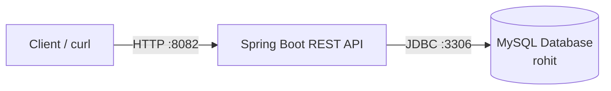

# Spring Boot CRUD API with MySQL and Docker

A REST API built using Spring Boot to perform CRUD operations on orders, with MySQL for data storage and Docker for containerization.

## Architecture



## Tech Stack

- **Java 17**
- **Spring Boot 2.6.1**
- **Spring Data JPA & Hibernate**
- **MySQL 9.7**
- **Docker**

## Project Structure

```text
springboot-crud-k8s/
├── Dockerfile
├── pom.xml
├── README.md
└── src/
    ├── main/
    │   ├── java/com/javatechie/crud/
    │   │   ├── controller/
    │   │   │   └── OrderController.java
    │   │   ├── entity/
    │   │   │   └── Order.java
    │   │   ├── repository/
    │   │   │   └── OrderRepository.java
    │   │   ├── service/
    │   │   │   └── OrderService.java
    │   │   └── SpringbootCrudK8sExampleApplication.java
    │   └── resources/
    │       ├── application.properties
    │       └── application.yml
    └── test/
```

## API Endpoints

| HTTP Method | Endpoint | Description |
|---|---|---|
| `GET` | `/orders` | Retrieve all orders |
| `GET` | `/orders/{id}` | Retrieve an order by ID |
| `POST` | `/orders` | Create a new order |

## Docker Configuration

| Setting | Value |
|---|---|
| Application container | `spring-crud-k8s` |
| Docker image | `spring-crud-k8s:1.0` |
| MySQL container | `mysql` |
| Docker network | `spring-net` |
| Application port | `8082` |
| Database | `rohit` |

## Run the Project

### 1. Build the Docker image

Run this from the project root:

```bash
docker build -t spring-crud-k8s:1.0 .
```

### 2. Start the application container

Ensure your MySQL container is running and connected to `spring-net`.

```bash
docker run -d \
  --name spring-crud-k8s \
  --restart unless-stopped \
  --network spring-net \
  -p 8082:8082 \
  -e DB_HOST="mysql:3306" \
  -e DB_NAME="rohit" \
  -e DB_USERNAME="root" \
  -e DB_PASSWORD='YOUR_MYSQL_PASSWORD' \
  spring-crud-k8s:1.0
```

Replace `YOUR_MYSQL_PASSWORD` with your configured MySQL password. Do not commit actual credentials to GitHub.

### 3. Test the API

Retrieve all orders:

```bash
curl http://localhost:8082/orders
```

Retrieve an order by ID:

```bash
curl http://localhost:8082/orders/1
```

Create an order:

```bash
curl -X POST http://localhost:8082/orders \
  -H "Content-Type: application/json" \
  -d '{"field":"value"}'
```

Replace the example JSON with the actual fields defined in `Order.java`.

## Useful Docker Commands

```bash
# Check running containers
docker ps

# View application logs
docker logs -f spring-crud-k8s

# Stop the application
docker stop spring-crud-k8s

# Start the application
docker start spring-crud-k8s

# Remove the application container
docker rm -f spring-crud-k8s
```

## Database Environment Variables

| Variable | Purpose |
|---|---|
| `DB_HOST` | MySQL hostname and port |
| `DB_NAME` | Database name |
| `DB_USERNAME` | Database username |
| `DB_PASSWORD` | Database password |

Both containers must be connected to the same Docker network so the Spring Boot application can reach MySQL using the hostname `mysql`.

## Key Features

- RESTful CRUD endpoints for orders
- MySQL database connectivity
- Spring Data JPA persistence
- Dockerized application deployment
- Environment-based database configuration
